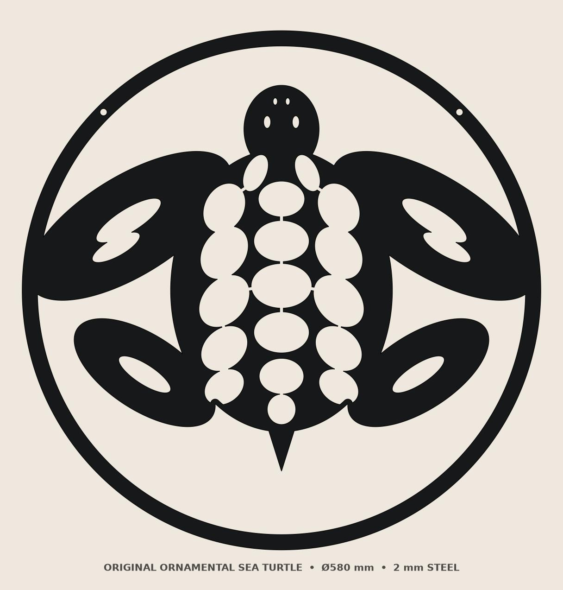

# Original Ornamental Sea Turtle CNC Panel

An original top-view sea turtle with clear head, neck, four flippers, shell scutes, and tail, naturally connected to a circular frame through its front flippers.



## Specification

- 580 mm diameter
- 2 mm mild steel
- One connected component
- Two 8 mm mounting holes
- 4.500 mm minimum measured profile separation
- 15 closed DXF profiles on `CUT`
- Net metal area: 118,810.03 mm²
- Estimated mass: 1.8653 kg

## Reproduce

```bash
uv run --with matplotlib --with shapely --with ezdxf python scripts/generate.py
```

Original procedural geometry; no external artwork or arbitrary support bars.

## License

CC0 1.0 Universal.
